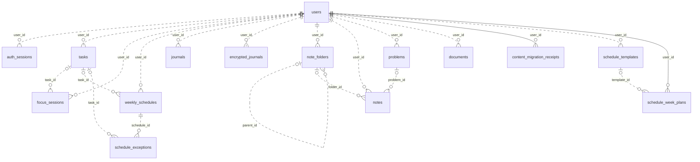

# FocusNest 数据库结构与学习指南

初版整理于 2026-11-11，更新于 2026-11-18。本文以当前 SQLAlchemy 模型和 Alembic 迁移为依据，覆盖迁移 `0018_schedule_templates` 下的 15 张业务表、141 个字段，另列 Alembic 迁移管理表。字段类型、可空性和键关系已与模型核对，实例中的实际结构仍待在线核对。 [数据库模型](../backend/app/models/) · [迁移脚本](../backend/alembic/versions/)

初读可以沿着 `users → tasks → focus_sessions` 观察主外键，再看 `weekly_schedules → schedule_exceptions` 如何表达重复和例外。最后对照 `notes`、`documents` 和两张日记表，理解内容保存方式如何影响表结构。

## 0. PK、FK 和 UQ 是什么

| 缩写 | 英文全称 | 中文含义 | 在 FocusNest 中的例子 |
| --- | --- | --- | --- |
| PK | Primary Key | 主键，唯一标识本表的一行，不能为空，也不能重复 | users.id 标识一个用户 |
| FK | Foreign Key | 外键，引用另一张表或本表的一组主键或唯一键，用于维持关联记录的有效性 | tasks.user_id 引用 users.id |
| UQ | Unique Constraint | 唯一约束，要求某列或某组列的非空值组合不能重复 | users.username 要求用户名唯一 |

例如，下面使用简化 ID 展示两张表中的关联，实际项目使用 UUID。

| users.id（PK） | username |
| --- | --- |
| U001 | 小王 |
| U002 | 小李 |

| tasks.id（PK） | tasks.user_id（FK） | title |
| --- | --- | --- |
| T001 | U001 | 学习数据库 |
| T002 | U001 | 完成英语练习 |
| T003 | U002 | 整理笔记 |

T001 和 T002 属于 U001，T003 属于 U002。任务 ID 必须各不相同。同一个用户可以拥有多个任务，因此 user_id 可以重复。外键约束启用时，填写非空 user_id 就必须能在 users.id 中找到对应值。

一张表可以用多列共同组成一个主键，称为联合主键。例如 schedule_week_plans 的主键是 (user_id, week_start)，两列组合必须唯一，每个用户在每周最多一条记录。user_id 在这里同时参与主键，并作为外键引用用户表。

MySQL 的可空唯一列允许多条 NULL。focus_sessions.active_user_id 正是利用这个特性，让活动记录使用用户 ID，并让多条历史记录使用 NULL。

## 1. ER 图



`||` 表示恰好一个，`|o` 表示零个或一个，`o{` 表示零个或多个。实线表示父表外键参与子表主键，例如迁移回执的 `user_id`。专注记录可用 `occurrence_key` 标识某个日程实例，但数据库没有从该字段指向日程表的外键。

| 父表 → 子表 | 外键 | 删除父记录时的动作 |
| --- | --- | --- |
| `users` → 图中直接关联的 13 张表 | `user_id` | `CASCADE`，删除从属行 |
| `tasks` → 专注记录、每周日程、日程例外 | `task_id` | `SET NULL`，保留从属行 |
| `schedule_templates` → 每周计划选择 | `template_id` | `SET NULL` |
| `weekly_schedules` → 日程例外 | `schedule_id` | `CASCADE` |
| `note_folders` → 子文件夹 | `parent_id` | `RESTRICT`，有子文件夹时限制删除 |
| `note_folders` → 笔记 | `folder_id` | `SET NULL` |
| `problems` → 笔记 | `problem_id` | `SET NULL` |

外键负责检查被引用的行是否存在。例如 `weekly_schedules.task_id` 指向任务主键，任务和日程是否属于同一个用户则由服务层按 `id` 和 `user_id` 一起校验。日程例外通过所属周日程取得归属，表内没有单独的 `user_id`。模板应用与每周选择的实现见 [日程模板服务](../backend/app/services/schedule_templates.py)。 [日程服务](../backend/app/services/schedules.py)

## 2. 全部表与逐字段数据字典

类型采用 MySQL 写法。可空表示允许 SQL NULL。BOOL 表示真假值，在 MySQL 中是 TINYINT(1) 的别名。应用将时间戳按 UTC 写入 DATETIME，DATE 用于业务日历日期。

多数 ID、创建时间和业务默认值由应用生成。迁移显式声明的数据库列默认值包括专注标题的空字符串、笔记与文档的 storage_mode 为 cloud，以及日程例外的 replaced 为 0。

| 表名 | 中文名称 | 用途 |
| --- | --- | --- |
| `users` | 用户表 | 保存账号与个人资料 |
| `auth_sessions` | 登录会话表 | 管理会话刷新、到期与撤销 |
| `tasks` | 任务表 | 保存任务及执行计划 |
| `focus_sessions` | 专注记录表 | 保存计时过程与结果 |
| `weekly_schedules` | 每周日程表 | 保存按星期重复的日程规则 |
| `schedule_exceptions` | 日程例外表 | 保存某一次日程的修改、跳过或替换 |
| `schedule_templates` | 日程模板表 | 保存可重复使用的一组日程 |
| `schedule_week_plans` | 每周计划选择表 | 记录用户某周采用的模板及确认状态 |
| `journals` | 历史云端日记表 | 保存历史明文日记 |
| `encrypted_journals` | 加密日记表 | 保存云端加密日记 |
| `note_folders` | 笔记文件夹表 | 保存文件夹和目录层级 |
| `notes` | 笔记表 | 保存笔记内容、归类及加密信息 |
| `problems` | 问题备忘表 | 保存待解决问题及解决状态 |
| `documents` | 文档资料表 | 保存文档原件、预览及加密信息 |
| `content_migration_receipts` | 内容迁移回执表 | 记录已完成的内容迁移，支持重复操作检查 |

### 2.1 用户表 `users`

| 字段 | MySQL 类型 | 可空 | 键与引用 | 含义 |
| --- | --- | --- | --- | --- |
| `id` | `VARCHAR(36)` | 否 | PK | 用户 UUID |
| `username` | `VARCHAR(32)` | 否 | UQ | 用户名 |
| `email` | `VARCHAR(254)` | 否 | UQ | 邮箱 |
| `password_hash` | `VARCHAR(255)` | 否 | — | 密码哈希 |
| `nickname` | `VARCHAR(64)` | 是 | — | 昵称 |
| `avatar_url` | `VARCHAR(2048)` | 是 | — | 头像地址 |
| `timezone` | `VARCHAR(64)` | 否 | — | 用户时区，例如 Asia/Shanghai |
| `created_at` | `DATETIME` | 否 | — | 创建时间 |
| `updated_at` | `DATETIME` | 否 | — | 更新时间 |

用户名和邮箱各自唯一，一个用户可以拥有多条任务和多条登录会话。 [模型源文件](../backend/app/models/user.py)

### 2.2 登录会话表 `auth_sessions`

| 字段 | MySQL 类型 | 可空 | 键与引用 | 含义 |
| --- | --- | --- | --- | --- |
| `id` | `VARCHAR(36)` | 否 | PK | 会话 UUID |
| `user_id` | `VARCHAR(36)` | 否 | FK → `users.id` | 所属用户 |
| `refresh_token_hash` | `VARCHAR(64)` | 否 | UQ | 刷新令牌的 SHA-256 摘要 |
| `expires_at` | `DATETIME` | 否 | — | 会话到期时间 |
| `revoked_at` | `DATETIME` | 是 | — | 会话撤销时间 |
| `created_at` | `DATETIME` | 否 | — | 创建时间 |

按用户、到期时间建立了普通索引。刷新会话时，应用通过条件更新轮换刷新令牌摘要。 [模型源文件](../backend/app/models/auth_session.py)

### 2.3 任务表 `tasks`

| 字段 | MySQL 类型 | 可空 | 键与引用 | 含义 |
| --- | --- | --- | --- | --- |
| `id` | `VARCHAR(36)` | 否 | PK | 任务 UUID |
| `user_id` | `VARCHAR(36)` | 否 | FK → `users.id` | 所属用户 |
| `title` | `VARCHAR(200)` | 否 | — | 任务标题 |
| `description` | `TEXT` | 是 | — | 任务描述 |
| `status` | `VARCHAR(16)` | 否 | — | 状态，todo 待办、doing 进行中、done 已完成 |
| `priority` | `VARCHAR(16)` | 否 | — | 优先级，low 低、medium 中、high 高 |
| `scheduled_date` | `DATE` | 是 | — | 计划执行日期 |
| `due_date` | `DATE` | 是 | — | 截止日期 |
| `estimated_minutes` | `INT` | 是 | — | 预计耗时，单位为分钟 |
| `completed_at` | `DATETIME` | 是 | — | 完成时间 |
| `created_at` | `DATETIME` | 否 | — | 创建时间 |
| `updated_at` | `DATETIME` | 否 | — | 更新时间 |

CHECK 约束限制状态和优先级的可选值，非空预计耗时为 1–10080 分钟。完成时间随状态设置或清空，由应用服务实现。 [模型源文件](../backend/app/models/task.py)

### 2.4 专注记录表 `focus_sessions`

| 字段 | MySQL 类型 | 可空 | 键与引用 | 含义 |
| --- | --- | --- | --- | --- |
| `id` | `VARCHAR(36)` | 否 | PK | 计时记录 UUID |
| `user_id` | `VARCHAR(36)` | 否 | FK → `users.id` | 所属用户 |
| `active_user_id` | `VARCHAR(36)` | 是 | UQ | 活动记录填写用户 ID，完成或取消后置空 |
| `task_id` | `VARCHAR(36)` | 是 | FK → `tasks.id` | 关联任务 |
| `title` | `VARCHAR(200)` | 否 | — | 计时标题 |
| `window_start` | `DATETIME(6)` | 是 | — | 固定时段的计划开始时间 |
| `window_end` | `DATETIME(6)` | 是 | — | 固定时段的计划结束时间 |
| `occurrence_key` | `VARCHAR(48)` | 是 | UQ | 日程实例标识，格式为日程 UUID 加冒号和日期 |
| `mode` | `VARCHAR(16)` | 否 | — | 模式，pomodoro 番茄钟、countdown 倒计时、stopwatch 正计时、scheduled 固定时段 |
| `kind` | `VARCHAR(16)` | 否 | — | 类型，focus 专注、break 休息 |
| `status` | `VARCHAR(16)` | 否 | — | 状态，scheduled 待开始、running 运行、paused 暂停、completed 完成、cancelled 取消 |
| `duration_seconds` | `INT` | 是 | — | 预设计时长度，单位为秒 |
| `elapsed_seconds` | `DOUBLE` | 否 | — | 已累计计时秒数 |
| `started_at` | `DATETIME(6)` | 否 | — | 开始时间 |
| `segment_started_at` | `DATETIME(6)` | 是 | — | 当前运行片段的开始时间 |
| `ended_at` | `DATETIME(6)` | 是 | — | 结束时间 |
| `updated_at` | `DATETIME(6)` | 否 | — | 更新时间 |

活动状态要求 active_user_id 等于 user_id，完成或取消则要求其为空。结合该列唯一约束，每个用户最多一条活动计时，多条历史记录可以共存。计时范围检查与输入默认值的说明见下文。 [模型源文件](../backend/app/models/focus_session.py)

### 2.5 每周日程表 `weekly_schedules`

| 字段 | MySQL 类型 | 可空 | 键与引用 | 含义 |
| --- | --- | --- | --- | --- |
| `id` | `VARCHAR(36)` | 否 | PK | 日程规则 UUID |
| `user_id` | `VARCHAR(36)` | 否 | FK → `users.id` | 所属用户 |
| `title` | `VARCHAR(200)` | 否 | — | 日程标题 |
| `notes` | `TEXT` | 否 | — | 日程备注 |
| `weekday` | `INT` | 否 | — | 星期，周一为 0，周日为 6 |
| `start_minute` | `INT` | 否 | — | 当天零点起的开始分钟数 |
| `end_minute` | `INT` | 否 | — | 当天零点起的结束分钟数 |
| `timezone` | `VARCHAR(64)` | 否 | — | 日程时区 |
| `effective_from` | `DATE` | 否 | — | 生效开始日期，含当天 |
| `effective_until` | `DATE` | 是 | — | 生效结束日期，含当天，空值表示无截止 |
| `task_id` | `VARCHAR(36)` | 是 | FK → `tasks.id` | 关联任务 |
| `timer_enabled` | `BOOL` | 否 | — | 是否启用计时 |
| `remind_start` | `BOOL` | 否 | — | 是否提醒开始 |
| `remind_end` | `BOOL` | 否 | — | 是否提醒结束 |
| `revision` | `INT` | 否 | — | 编辑版本号，更新时递增 |

CHECK 约束限制 weekday 为 0–6，start_minute 至少为 0，end_minute 至多为 1440，并且开始时间早于结束时间。例如 19 点到 20 点保存为 1140–1200 分钟。 [模型源文件](../backend/app/models/schedule.py)

### 2.6 日程例外表 `schedule_exceptions`

| 字段 | MySQL 类型 | 可空 | 键与引用 | 含义 |
| --- | --- | --- | --- | --- |
| `id` | `VARCHAR(36)` | 否 | PK | 例外记录 UUID |
| `schedule_id` | `VARCHAR(36)` | 否 | FK → `weekly_schedules.id` | 所属周日程规则 |
| `occurrence_date` | `DATE` | 否 | — | 例外对应的具体日期 |
| `skipped` | `BOOL` | 否 | — | 是否跳过本次日程 |
| `replaced` | `BOOL` | 否 | — | 该次日程是否已被模板应用替换 |
| `title` | `VARCHAR(200)` | 否 | — | 本次标题 |
| `notes` | `TEXT` | 否 | — | 本次备注 |
| `start_minute` | `INT` | 否 | — | 本次开始分钟数 |
| `end_minute` | `INT` | 否 | — | 本次结束分钟数 |
| `task_id` | `VARCHAR(36)` | 是 | FK → `tasks.id` | 本次关联任务 |
| `timer_enabled` | `BOOL` | 否 | — | 本次是否启用计时 |
| `remind_start` | `BOOL` | 否 | — | 本次是否提醒开始 |
| `remind_end` | `BOOL` | 否 | — | 本次是否提醒结束 |

联合唯一约束为 `(schedule_id, occurrence_date)`。

联合唯一约束保证同一规则在同一天最多一条例外。例外通过所属周日程取得用户归属。 [模型源文件](../backend/app/models/schedule.py)

### 2.7 日程模板表 `schedule_templates`

| 字段 | MySQL 类型 | 可空 | 键与引用 | 含义 |
| --- | --- | --- | --- | --- |
| `id` | `VARCHAR(36)` | 否 | PK | 模板 UUID |
| `user_id` | `VARCHAR(36)` | 否 | FK → `users.id` | 所属用户 |
| `name` | `VARCHAR(80)` | 否 | — | 模板名称 |
| `entries` | `JSON` | 否 | — | 模板日程条目数组，每个条目为一个 JSON 对象 |

联合唯一约束为 `(user_id, name)`。

同一用户的模板名称唯一。JSON 中包含的任务 ID 等条目内容由应用解释和校验。 [模型源文件](../backend/app/models/schedule.py)

### 2.8 每周计划选择表 `schedule_week_plans`

| 字段 | MySQL 类型 | 可空 | 键与引用 | 含义 |
| --- | --- | --- | --- | --- |
| `user_id` | `VARCHAR(36)` | 否 | 联合 PK，FK → `users.id` | 所属用户 |
| `week_start` | `DATE` | 否 | 联合 PK | 该周的开始日期 |
| `template_id` | `VARCHAR(36)` | 是 | FK → `schedule_templates.id` | 该周选择的模板 |
| `reviewed` | `BOOL` | 否 | — | 是否已确认该周安排 |

用户与周开始日期共同组成主键，因此每个用户每周最多一条记录。 [模型源文件](../backend/app/models/schedule.py)

### 2.9 历史云端日记表 `journals`

| 字段 | MySQL 类型 | 可空 | 键与引用 | 含义 |
| --- | --- | --- | --- | --- |
| `id` | `VARCHAR(36)` | 否 | PK | 日记 UUID |
| `user_id` | `VARCHAR(36)` | 否 | FK → `users.id` | 所属用户 |
| `entry_date` | `DATE` | 否 | — | 日记归属日期 |
| `title` | `VARCHAR(200)` | 否 | — | 日记标题 |
| `content` | `MEDIUMTEXT` | 否 | — | 日记正文 |
| `revision` | `VARCHAR(36)` | 否 | — | 编辑版本标识 |
| `created_at` | `DATETIME(6)` | 否 | — | 创建时间 |
| `updated_at` | `DATETIME(6)` | 否 | — | 更新时间 |

联合唯一约束为 `(user_id, entry_date)`。

每个用户每天最多一条历史云端日记。默认本地日记保存在本地 Markdown 文件中。 [模型源文件](../backend/app/models/journal.py)

### 2.10 加密日记表 `encrypted_journals`

| 字段 | MySQL 类型 | 可空 | 键与引用 | 含义 |
| --- | --- | --- | --- | --- |
| `id` | `VARCHAR(36)` | 否 | PK | 日记 UUID |
| `user_id` | `VARCHAR(36)` | 否 | FK → `users.id` | 所属用户 |
| `entry_date` | `DATE` | 否 | — | 日记归属日期 |
| `encrypted_payload` | `MEDIUMTEXT` | 否 | — | 加密后的日记内容 |
| `revision` | `VARCHAR(36)` | 否 | — | 编辑版本标识 |
| `created_at` | `DATETIME(6)` | 否 | — | 创建时间 |
| `updated_at` | `DATETIME(6)` | 否 | — | 更新时间 |

联合唯一约束为 `(user_id, entry_date)`。

每个用户每天最多一条加密日记。日期唯一约束分别在两张日记表内生效。 [模型源文件](../backend/app/models/journal.py)

### 2.11 笔记文件夹表 `note_folders`

| 字段 | MySQL 类型 | 可空 | 键与引用 | 含义 |
| --- | --- | --- | --- | --- |
| `id` | `VARCHAR(36)` | 否 | PK | 文件夹 UUID |
| `user_id` | `VARCHAR(36)` | 否 | FK → `users.id` | 所属用户 |
| `parent_id` | `VARCHAR(36)` | 是 | FK → `note_folders.id` | 父文件夹，空值表示根层级 |
| `name` | `VARCHAR(100)` | 否 | — | 文件夹名称 |
| `revision` | `VARCHAR(36)` | 否 | — | 编辑版本标识 |

parent_id 引用本表，形成多级目录。同一层级重名检查由服务在用户锁内完成。 [模型源文件](../backend/app/models/note_folder.py)

### 2.12 笔记表 `notes`

| 字段 | MySQL 类型 | 可空 | 键与引用 | 含义 |
| --- | --- | --- | --- | --- |
| `id` | `VARCHAR(36)` | 否 | PK | 笔记 UUID |
| `user_id` | `VARCHAR(36)` | 否 | FK → `users.id` | 所属用户 |
| `folder_id` | `VARCHAR(36)` | 是 | FK → `note_folders.id` | 所在文件夹 |
| `title` | `VARCHAR(200)` | 是 | — | 普通云端笔记的标题 |
| `problem_id` | `VARCHAR(36)` | 是 | FK → `problems.id` | 关联问题 |
| `content` | `MEDIUMTEXT` | 是 | — | 普通云端笔记的正文 |
| `storage_mode` | `VARCHAR(24)` | 否 | — | 保存方式，cloud 普通云端、cloud_encrypted 云端加密 |
| `encrypted_payload` | `MEDIUMTEXT` | 是 | — | 加密后的标题和正文 |
| `content_revision` | `VARCHAR(36)` | 是 | — | 加密内容的独立版本标识 |
| `pinned` | `BOOL` | 否 | — | 是否置顶 |
| `revision` | `VARCHAR(36)` | 否 | — | 整条笔记的编辑版本标识 |
| `created_at` | `DATETIME(6)` | 否 | — | 创建时间 |
| `updated_at` | `DATETIME(6)` | 否 | — | 更新时间 |

CHECK 约束要求 cloud 模式的标题、正文有值，密文和内容版本为空。cloud_encrypted 模式要求密文和内容版本有值，标题、正文为空。元数据操作可以更新 revision，并继续使用原来的 content_revision。 [模型源文件](../backend/app/models/note.py)

### 2.13 问题备忘表 `problems`

| 字段 | MySQL 类型 | 可空 | 键与引用 | 含义 |
| --- | --- | --- | --- | --- |
| `id` | `VARCHAR(36)` | 否 | PK | 问题 UUID |
| `user_id` | `VARCHAR(36)` | 否 | FK → `users.id` | 所属用户 |
| `content` | `TEXT` | 否 | — | 问题内容 |
| `is_resolved` | `BOOL` | 否 | — | 是否已解决 |
| `resolved_at` | `DATETIME(6)` | 是 | — | 解决时间 |
| `revision` | `VARCHAR(36)` | 否 | — | 编辑版本标识 |
| `created_at` | `DATETIME(6)` | 否 | — | 创建时间 |
| `updated_at` | `DATETIME(6)` | 否 | — | 更新时间 |

CHECK 约束要求已解决时填写 resolved_at，未解决时该字段为空。 [模型源文件](../backend/app/models/problem.py)

### 2.14 文档资料表 `documents`

| 字段 | MySQL 类型 | 可空 | 键与引用 | 含义 |
| --- | --- | --- | --- | --- |
| `id` | `VARCHAR(36)` | 否 | PK | 文档 UUID |
| `user_id` | `VARCHAR(36)` | 否 | FK → `users.id` | 所属用户 |
| `title` | `VARCHAR(200)` | 是 | — | 普通云端文档标题 |
| `filename` | `VARCHAR(255)` | 是 | — | 原文件名 |
| `kind` | `VARCHAR(16)` | 否 | — | 文档类型 |
| `size_bytes` | `INT` | 否 | — | 原文件大小，单位为字节 |
| `raw_content` | `MEDIUMBLOB` | 是 | — | 普通云端文档的原始二进制内容 |
| `preview_data` | `JSON` | 是 | — | 结构化预览数据 |
| `storage_mode` | `VARCHAR(24)` | 否 | — | 保存方式，cloud 或 cloud_encrypted |
| `encrypted_file` | `MEDIUMTEXT` | 是 | — | 文件原件密文 |
| `encrypted_metadata` | `MEDIUMTEXT` | 是 | — | 标题、文件名及预览等元数据的密文 |
| `revision` | `VARCHAR(36)` | 否 | — | 编辑版本标识 |
| `created_at` | `DATETIME(6)` | 否 | — | 创建时间 |
| `updated_at` | `DATETIME(6)` | 否 | — | 更新时间 |

类型限制为 markdown、text、pdf、word、presentation、spreadsheet。文件大小为 1 字节到 10 MiB。普通云端模式填写标题、文件名和原件，预览可空，两列密文为空。加密模式填写两列密文，标题、文件名、原件和预览均为空。 [模型源文件](../backend/app/models/document.py)

### 2.15 内容迁移回执表 `content_migration_receipts`

| 字段 | MySQL 类型 | 可空 | 键与引用 | 含义 |
| --- | --- | --- | --- | --- |
| `user_id` | `VARCHAR(36)` | 否 | 联合 PK，FK → `users.id` | 所属用户 |
| `kind` | `VARCHAR(16)` | 否 | 联合 PK | 来源内容类型 |
| `source_id` | `VARCHAR(36)` | 否 | 联合 PK | 来源记录 ID |
| `source_revision` | `VARCHAR(36)` | 否 | 联合 PK | 来源记录版本 |
| `target_revision` | `VARCHAR(36)` | 否 | — | 迁移完成后的版本 |
| `completed_at` | `DATETIME(6)` | 否 | — | 迁移完成时间 |

前四列共同组成主键。source_id 根据 kind 由服务解释。服务先按联合主键查回执，重复提交时返回已迁移结果。 [模型源文件](../backend/app/models/migration_receipt.py)

### 2.16 Alembic 迁移管理表 `alembic_version`

| 字段 | MySQL 类型 | 可空 | 键与引用 | 含义 |
| --- | --- | --- | --- | --- |
| `version_num` | `VARCHAR(32)` | 否 | PK | 数据库已应用的迁移版本 |

该表由 Alembic 管理。当前源码迁移终点为 `0018_schedule_templates`，具体实例的已应用版本需查询该表确认。

### 2.17 专注时长的约束与应用默认值

专注表 CHECK 接受结果为 UNKNOWN 的表达式，因此 duration_seconds 为空时可以通过倒计时和番茄钟的范围检查。应用在用户省略这两类计时时长时，按专注或休息分别补上 1500 秒或 300 秒。非空时长限制为 60–86400 秒，正计时和固定时段的 duration_seconds 要求为空，累计秒数至少为 0。 [专注输入校验](../backend/app/schemas/focus.py)

## 3. 索引与查询的关系

下表列出模型和迁移显式创建的普通索引。主键和唯一约束也由 MySQL 用索引实现。MySQL 还可能为外键补建所需索引，实例中的完整列表可用 `SHOW INDEX` 查看。

| 表 | 索引名 | 列顺序 | 对应的查询 |
| --- | --- | --- | --- |
| `auth_sessions` | `ix_auth_sessions_user_id`、`ix_auth_sessions_expires_at` | `(user_id)`、`(expires_at)` | 按账号查会话、按过期时间查找 |
| `tasks` | `ix_tasks_user_created` | `(user_id, created_at, id)` | 用户任务按创建时间排序，`id` 用于同时间排序 |
| `tasks` | `ix_tasks_user_scheduled`、`ix_tasks_user_due` | `(user_id, scheduled_date)`、`(user_id, due_date)` | 查询某用户的计划日期或截止日期范围 |
| `focus_sessions` | `ix_focus_user_started` | `(user_id, started_at, id)` | 查询用户计时历史 |
| `weekly_schedules` | `ix_schedule_user_dates` | `(user_id, effective_from, effective_until)` | 按账号查可能与区间重叠的周规则 |
| `note_folders` | `ix_note_folders_user_parent` | `(user_id, parent_id)` | 按账号查根目录或某文件夹的子目录 |
| `notes` | `ix_notes_user_pinned_updated` | `(user_id, pinned, updated_at, id)` | 按账号查笔记，置顶优先，再按更新时间排序 |
| `notes` | `ix_notes_folder_id`、`ix_notes_problem_id` | `(folder_id)`、`(problem_id)` | 按文件夹或问题查关联笔记 |
| `problems` | `ix_problems_user_status_created` | `(user_id, is_resolved, created_at, id)` | 按账号和解决状态筛选问题，再按时间排序 |
| `documents` | `ix_documents_user_created` | `(user_id, created_at, id)` | 查询用户文档并按创建时间排序 |

例如，`(user_id, scheduled_date)` 把同一用户的日期范围排在一起。查询同时用 `user_id = …` 和日期范围时，可以用 `EXPLAIN` 观察优化器是否选择该索引。过滤条件、排序和数据量都会影响执行计划。 [任务模型](../backend/app/models/task.py) · [任务查询](../backend/app/repositories/tasks.py)

## 4. 用 SQL 验证自己的理解

下面的 `:user_id`、`:schedule_id` 和日期参数是 SQLAlchemy 的绑定参数。使用 MySQL 客户端时，可以先把它们替换成带引号的测试值。三条查询已在隔离的 SQLite 内存库中用模拟记录验证。

### 按计划日期查看一周任务

日期范围使用左闭右开区间。查询一整周时，将 `:week_end` 设为下周第一天。

```sql
SELECT id, title, scheduled_date, due_date, status
FROM tasks
WHERE user_id = :user_id
  AND scheduled_date >= :week_start
  AND scheduled_date < :week_end
ORDER BY scheduled_date, id;
```

### 统计每个任务的已完成专注秒数

把专注表的筛选条件放在 `LEFT JOIN ... ON` 中，可以让没有合格记录的任务也显示出来，累计值为 `0`。

```sql
SELECT t.id, t.title,
       COUNT(f.id) AS session_count,
       COALESCE(SUM(f.elapsed_seconds), 0) AS total_seconds
FROM tasks AS t
LEFT JOIN focus_sessions AS f
  ON f.task_id = t.id
 AND f.user_id = t.user_id
 AND f.kind = 'focus'
 AND f.status = 'completed'
WHERE t.user_id = :user_id
GROUP BY t.id, t.title
ORDER BY total_seconds DESC, t.id;
```

### 查看某条周日程有哪些单次修改

查询已有例外。完整周视图还需由应用按星期、有效期和时区展开，并合并例外。

```sql
SELECT e.occurrence_date, e.skipped, e.title,
       e.start_minute, e.end_minute
FROM weekly_schedules AS s
JOIN schedule_exceptions AS e ON e.schedule_id = s.id
WHERE s.user_id = :user_id AND s.id = :schedule_id
ORDER BY e.occurrence_date;
```

## 5. 查看实际数据库结构

连接自己的 MySQL 练习库后，可以用以下命令查看表定义、索引及迁移版本。这些命令只读取结构和迁移元数据。

```sql
SHOW TABLES;
SHOW CREATE TABLE focus_sessions;
SHOW INDEX FROM tasks;
SELECT version_num FROM alembic_version;
```

也可以在项目的 `backend` 目录生成从空库到最新版本的离线 MySQL SQL，供阅读各次迁移中的 `CREATE TABLE`、`ALTER TABLE` 和 `CREATE INDEX`。命令输出 SQL，不执行迁移。

```powershell
.\.venv\Scripts\python.exe -m alembic upgrade head --sql
```
